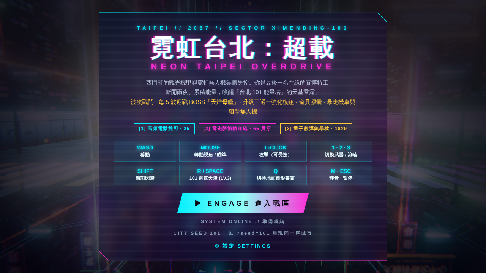
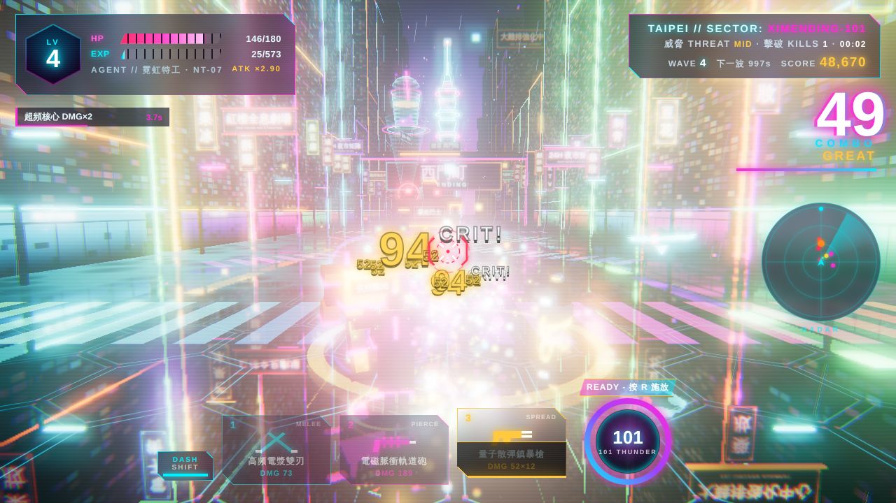
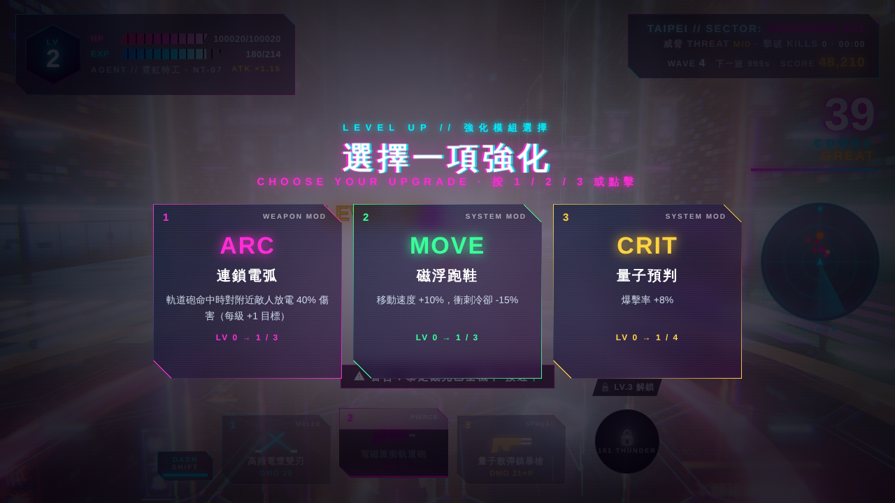
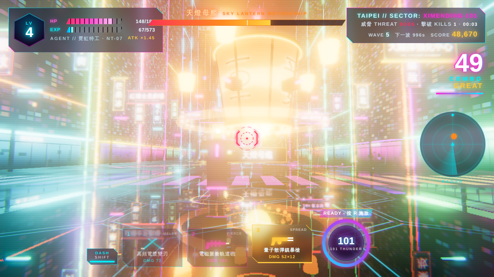
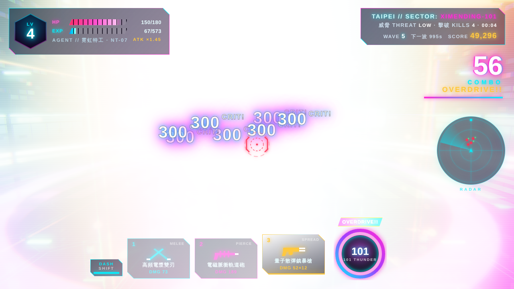

# 霓虹台北：超載 NEON TAIPEI // OVERDRIVE

## 簡介

《霓虹台北：超載》是一款在瀏覽器裡執行的 3D 賽博龐克動作戰鬥遊戲。舞台是西門町與信義商圈融合而成的雨夜台北：潮濕的柏油路倒映著滿街繁體中文霓虹招牌，彩虹斑馬線在腳下流動，遠方的「台北 101 能量塔」不斷湧出青色與紫紅色的能量流光。你扮演最後一名在線的賽博特工，揮舞電漿雙刃、軌道砲與量子散彈槍，對抗一波波失控的觀光機甲、霓虹無人機、暴走機車，以及每五波降臨一次的巨型 BOSS「天燈母艦」。擊敗敵人累積經驗、在升級時挑選強化模組，升到 LV.3 之後就能喚醒 101 能量塔，發動天基雷射「101 雷霆天降」清空整個戰場。

整個遊戲只有一個 `index.html`：所有招牌、地面、角色與敵人模型、粒子特效都在執行時用程式繪製與組合，音樂與音效也是即時合成。專案裡沒有任何圖片、模型或音訊檔，也不需要建置步驟。

## 快速開始

**直接開啟**

用桌面版 Chrome、Edge 或 Firefox 開啟 `index.html`，點擊「ENGAGE 進入戰區」即可開始。遊戲會從 CDN 載入 three.js 與 Google Fonts，所以第一次開啟需要網路連線；字型載入失敗時會自動改用系統字型。

**用靜態伺服器**

如果瀏覽器限制本機檔案，或你想在區網內分享，任選一種靜態伺服器：

```bash
python3 -m http.server 8080
# 或
npx http-server -p 8080
```

然後開啟 <http://localhost:8080/>。

**用 `?seed=` 指定種子**

城市佈局（大樓高度與位置、招牌配置、地面紋理、空中車流等）由種子決定。在網址後加上 `?seed=`，同一個種子永遠會生成同一座城市：

```text
index.html?seed=101
http://localhost:8080/?seed=taipei
```

種子可以是任意文字（最多 32 字元）。沒有指定時會隨機產生一個，並顯示在開始畫面與結算畫面上，方便你記下來分享。種子只影響城市外觀；敵人生成、爆擊與掉落仍是隨機的。

## 截圖展示

> 以下截圖是在無 GPU 的環境用軟體渲染擷取（`?seed=101`）。在一般顯示卡上執行時畫面相同，但幀率流暢許多。

| | |
|---|---|
|  |  |
| **開始畫面**：操作說明、城市種子與設定 | **街頭混戰**：軌道砲貫穿，HUD 顯示波次、分數與連擊 |
|  |  |
| **升級三選一**：從 13 種強化模組中挑選 | **BOSS 戰**：天燈母艦與頂部血條 |
|  | |
| **必殺技命中瞬間**：全場閃白，連鎖閃電讓每個敵人各受 300 傷害 | |

## 操作方式

| 按鍵 | 動作 |
|---|---|
| `W` `A` `S` `D` | 移動 |
| 滑鼠移動 | 轉動視角／瞄準（準星對準敵人時會變紅鎖定） |
| 滑鼠左鍵（可長按） | 攻擊 |
| `1` `2` `3`／滑鼠滾輪 | 切換武器 |
| `Shift`／滑鼠右鍵 | 衝刺閃避（衝刺期間無敵） |
| `R`／`Space` | 必殺技「101 雷霆天降」（LV.3 解鎖、能量滿時） |
| `1` `2` `3`（升級畫面） | 選擇強化模組（也可直接點擊卡片） |
| `Q` | 切換地面即時倒影（關閉可提升效能） |
| `M` | 靜音 |
| `Esc` | 暫停（暫停畫面可調整靈敏度、音量、畫面震動） |
| 方向鍵 | 備用視角控制（無法鎖定滑鼠時使用） |

第一次點擊畫面時會鎖定滑鼠游標；按 `Esc` 解除並暫停。

## 玩法

**武器**

| 武器 | 定位 | 傷害 | 特性 |
|---|---|---|---|
| 1．高頻電漿雙刃 | 近戰高速斬擊 | 25 | 青色弧形刀光、攻速快、微幅擊退，還能斬掉敵方子彈 |
| 2．電磁脈衝軌道砲 | 遠程貫穿狙擊 | 65 | 洋紅雷射直線貫穿所有敵人，附環狀電磁波與畫面震動，冷卻較長 |
| 3．量子散彈鎮暴槍 | 中近距離壓制 | 18 × 9 | 扇形金色彈丸，強力擊退並短暫緩速，近距離全中可破百 |

每種武器都有爆擊，爆擊時傷害數字會放大並標示 CRIT。

**波次與 BOSS**

敵人以波次出現，每波清空後會修復 15% HP、獲得波次獎勵分數並施放小型煙火。波數越高，敵人越多、越耐打，種類也越多。每第 5 波會出現 BOSS「天燈母艦」，攻擊模式包括環形彈幕、瞄準連射、召喚無人機；血量低於一半進入第二階段，還會從天空投下燃燒天燈。擊墜後在 101 上空施放跨年式煙火，並掉落多顆道具膠囊。

**敵人**

| 敵人 | 行為 |
|---|---|
| 霓虹無人機 | 在空中盤旋射擊，不時俯衝撞擊 |
| 失控觀光機甲 | 地面推進，近身蓄力重擊 |
| 暴走機車 | 鎖定方向後高速衝撞並自爆；被擊破時的爆炸也會波及其他敵人 |
| 狙擊無人機 | 遠距離瞄準，先拉出紅色預警線再開火，看到紅線要閃開 |
| 暴走觀光巴士機甲 | 重裝單位，五連發扇形砲擊與重拳 |
| 天燈母艦（BOSS） | 每 5 波出現，兩階段攻擊 |

**經驗、等級與強化模組**

擊敗敵人會掉落綠色經驗晶球（靠近時自動吸取）。每次升級會爆發金色光柱、提升最大 HP 與基礎傷害，並暫停戰鬥讓你從三張隨機卡片中挑選一項強化。共 13 種：

- 數值強化：傷害、爆擊率、冷卻、移速、最大 HP、擊殺回血、拾取範圍與經驗加成、必殺充能速度。
- 霓虹力場：定期生成可抵擋一次傷害的護盾。
- 全息衛星：環繞你的能量球，碰到敵人就造成傷害。
- 電漿劍氣：雙刃揮砍時射出貫穿劍氣。
- 連鎖電弧：軌道砲命中後對附近敵人放電。
- 彈丸增幅：散彈槍增加彈丸數。

**必殺技：台北超載・101 雷霆天降**

升到 LV.3 解鎖，能量會隨命中、擊殺與時間累積。能量滿時按 `R` 施放：全場進入慢動作並閃現霓虹色差，台北 101 能量塔射出巨型天基雷射轟擊戰場，連鎖閃電逐一擊中所有敵人，每個敵人受到 300 傷害，小型無人機直接清除。

**道具膠囊**

| 道具 | 效果 |
|---|---|
| 超頻核心 | 8 秒內傷害 ×2 |
| 神經急速 | 8 秒內冷卻減半、移速 +30% |
| 霓虹護盾 | 抵擋 3 次傷害 |
| 珍奶補給 | 回復 40 HP |

**分數**

擊殺得分會乘上連擊倍率（最高 ×3），清波另有獎勵。結算時依分數給予 S／A／B／C 評級，最高紀錄會存在瀏覽器的 localStorage 裡。

## 渲染技術

- **Three.js r160**：透過 `<script type="importmap">` 從 jsDelivr 載入 `three` 與 `three/addons/`，不需要打包工具。
- **後處理鏈**：`EffectComposer` → `RenderPass` → `UnrealBloomPass`（HDR 輝光）→ 自訂 `ShaderPass`（RGB 色差、掃描線、暗角、故障位移、受傷紅邊、必殺霓虹色調）→ `OutputPass`（ACES 色調映射與 sRGB 轉換）。發光材質使用大於 1 的 HDR 顏色，交給 Bloom 產生霓虹光暈。
- **潮濕地面倒影**：底層是 `Reflector` 即時鏡面，上面疊一層半透明柏油材質，水窪區域透明度較高，所以招牌倒影會從積水處透出來。地面材質用 `onBeforeCompile` 注入著色器，讓六角能量格紋在玩家周圍發亮並向外擴散波紋；必殺技命中時還會推出一道衝擊環。雨絲、浮游粒子、血條等裝飾物放在獨立圖層，不參與鏡面渲染以節省效能。
- **程式生成的貼圖**：所有招牌（直式、橫式、牌樓）、大樓窗戶、店面、地面六角紋、天燈紙面都用 `CanvasTexture` 即時繪製，文字使用 Noto Sans TC 與 Orbitron。
- **程式生成的模型**：特工、機甲、機車、無人機、天燈母艦與 101 能量塔，都是由基本幾何體組合而成。101 能量塔使用自訂著色器，呈現沿稜線與樓層向上流動的能量。
- **環境光照**：用 `PMREMGenerator` 把一個由霓虹面板組成的小場景烘焙成環境貼圖，讓金屬材質反射霓虹色光。天空是程式化的漸層與星空著色器。
- **特效系統**：GPU 點粒子（5,000 顆，加法混合）負責火花、爆炸與煙火；`InstancedMesh` 負責幾何碎片與斑馬線；刀光、雷射光束、光柱與震波環都使用自訂著色器；連鎖閃電是每幀重新抖動的折線。
- **效能**：靜態城市幾何依材質合併（`BufferGeometryUtils.mergeGeometries`），招牌材質依貼圖共用。整個場景閒置時約 365 個繪製呼叫，二十多隻敵人同時在場時約 900 個。
- **音訊**：用 WebAudio 即時合成所有音效與一首 108 BPM 的合成器浪潮配樂，戰況越激烈、BOSS 出現時，配樂會自動加強。
- **種子**：`?seed=` 會經過字串雜湊後交給 mulberry32 偽隨機數產生器，只在生成世界時暫時取代 `Math.random`。

## 專案結構

```text
neon-taipei-overdrive/
├── index.html                # 整個遊戲：HTML 介面 + CSS HUD + JavaScript 模組
├── README.md
└── docs/
    └── screenshots/          # README 用截圖
```

`index.html` 內部依區段組織，每段開頭都有編號註解：

| 區段 | 內容 |
|---|---|
| 0. Utilities／種子 | 數學工具、`?seed=` 雜湊與 mulberry32 |
| 1. Audio | WebAudio 音效與合成配樂 |
| 2. Renderer / Post-FX | 渲染器、場景、後處理鏈 |
| 3. Canvas Textures | 霓虹招牌、窗戶、店面貼圖產生器 |
| 4–7. 環境／地面／城市／101 | 天空、燈光、潮濕倒影地面、街景、能量塔 |
| 8–9. 粒子與特效 | GPU 粒子、碎片、刀光、光束、震波、閃電 |
| 10–11. 角色與敵人模型 | 特工與武器、無人機、機甲 |
| 12–14. 狀態、HUD、戰鬥 | 遊戲狀態、浮動傷害數字、三把武器 |
| 15–15d. 敵人 AI、波次、強化 | 生成與 AI、機車／狙擊／BOSS、波次、強化模組、道具、分數 |
| 16. 必殺技 | 101 雷霆天降 |
| 17–19. 輸入、相機、HUD 更新 | 滑鼠鎖定、第三人稱相機、雷達 |
| 20–22. 流程、主迴圈、啟動 | 開始／結算／重來、遊戲迴圈、世界生成 |

除錯用：瀏覽器主控台可以使用 `window.NTO`（例如 `NTO.startWave(5)` 直接跳到 BOSS 波）。
